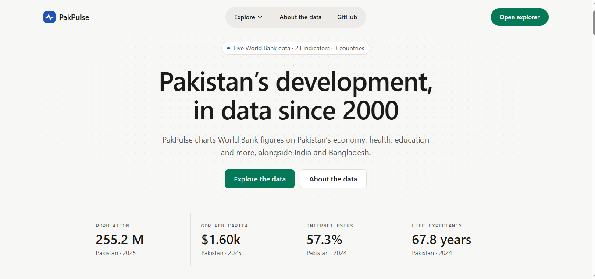
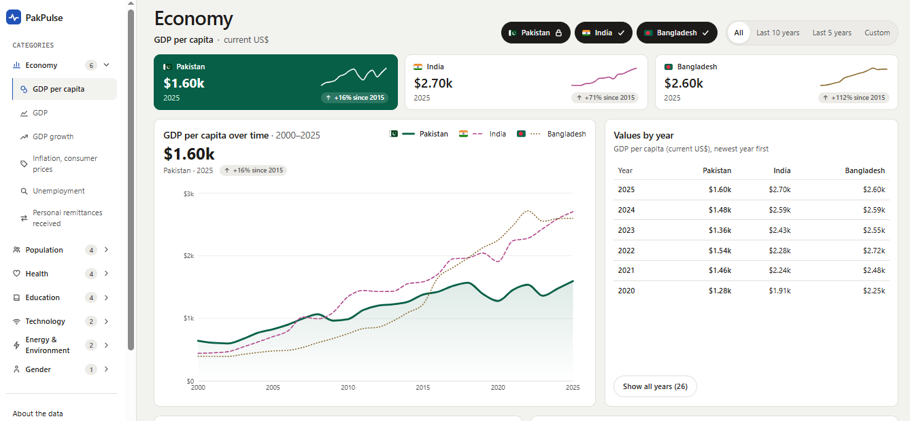

# PakPulse

An interactive explorer of World Bank data on Pakistan's development, compared with India and Bangladesh since 2000.

**Live site:** https://pakpulse.vercel.app

## Screenshots





## Features

- 23 indicators in 7 categories: Economy, Population, Health, Education, Technology, Energy & Environment, and Gender.
- A line chart comparing Pakistan, India and Bangladesh, with Pakistan highlighted.
- Show or hide India and Bangladesh, and choose the range of years.
- Summary cards with each country's latest value and its year.
- A search box for finding an indicator by name.
- The selected category and indicator are kept in the URL, so Back, Forward and reloads keep your place.
- Loading, error ("Try again") and no-data states.
- Each indicator's description and a link to its World Bank source.

## Data

- All figures come from the [World Bank, World Development Indicators](https://data.worldbank.org), licensed under [CC BY 4.0](https://creativecommons.org/licenses/by/4.0/). Attribution: "Data: World Bank, World Development Indicators".
- Data is loaded live from the World Bank API on each visit, and nothing is stored in the app.
- Figures usually trail the current year by one to two years, and the latest year can differ by country and indicator. Every value is shown with its year.
- Missing years are shown as gaps, never as zero.
- Some figures are modelled estimates, for example unemployment and female labour force participation from the International Labour Organization (ILO).

## Tech stack

- [React](https://react.dev) (JavaScript)
- [Vite](https://vite.dev)
- [Tailwind CSS v4](https://tailwindcss.com)
- [Recharts](https://recharts.org) for charts
- [React Router](https://reactrouter.com) for pages and URLs
- [World Bank API](https://datahelpdesk.worldbank.org/knowledgebase/articles/889392), called with the browser's native `fetch`

There is no backend.

## Project structure

```
src/
  data/        Configuration: the list of indicators and categories, the countries, and page text
  lib/         Plain JavaScript: fetching and caching World Bank data, formatting values, preparing chart rows
  components/  Reusable UI pieces: navbar, footer, chart, summary cards, controls
  pages/       One file per page: HomePage, ExplorePage, NotFoundPage
```

To add an indicator, add one entry to `src/data/indicators.js`. The UI is built from that list.

## Run locally

You need [Node.js](https://nodejs.org) installed.

```bash
npm install
npm run dev
```

Then open the address Vite prints (usually http://localhost:5173).

## Accessibility

- Every tab, button and control works with a keyboard, with a visible focus outline. A "Skip to content" link comes first.
- Text and country colours meet WCAG AA contrast. Country lines also differ in style and are always labelled, never shown by colour alone.
- Controls have screen reader labels, decorative icons are hidden from screen readers, and loading and search results are announced.

## Disclaimer

PakPulse is an independent project. It is not affiliated with or endorsed by the World Bank.
